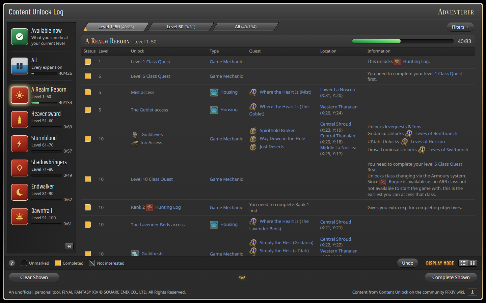
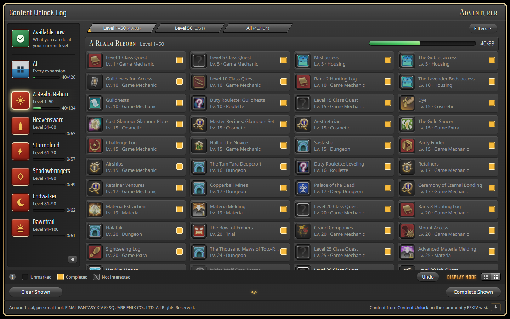
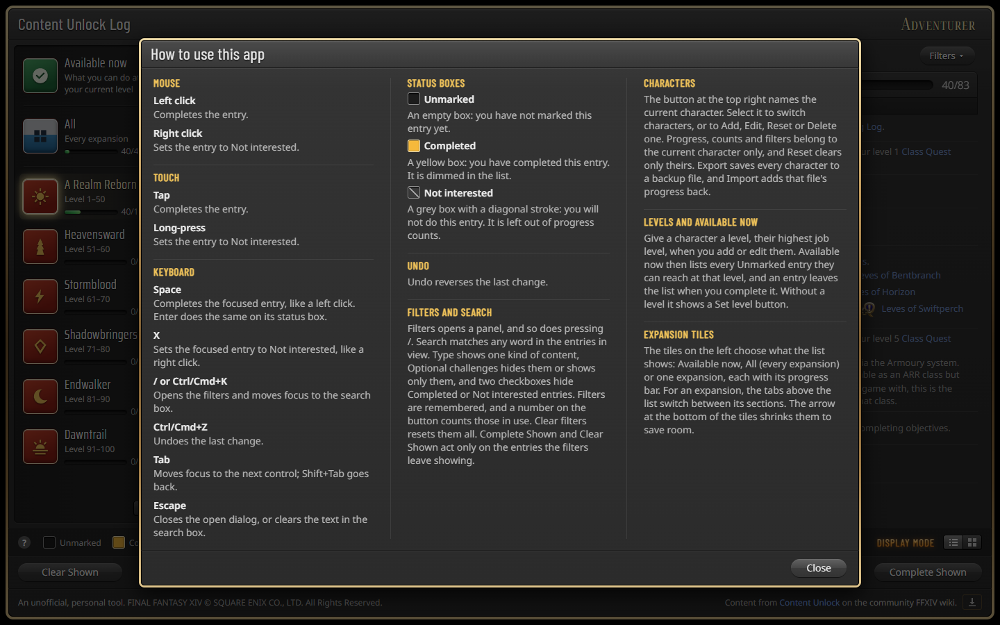
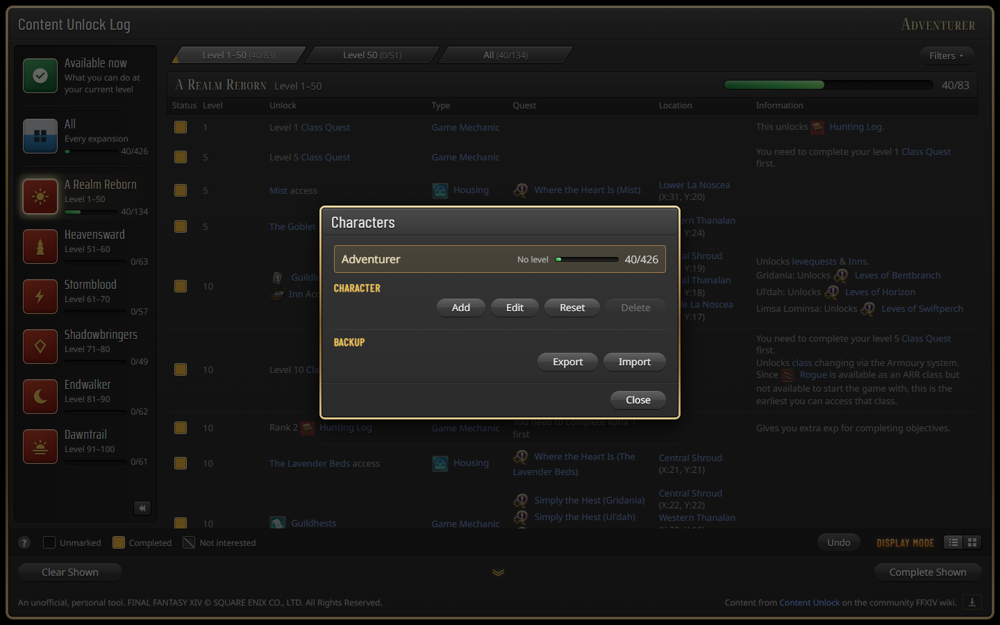

# FFXIV Content Unlock Log

A personal checklist of Final Fantasy XIV content unlocks. It takes the community wiki's
[Content Unlock](https://ffxiv.consolegameswiki.com/wiki/Content_Unlock) page (over 400 dungeons,
trials, raids, jobs and game features, grouped by expansion and level) and lets you record which
entries each of your characters has done.

**Live app: <https://liammoseley.github.io/ffxiv-contentunlockchecklist/>**

> An unofficial fan tool. FINAL FANTASY XIV © SQUARE ENIX CO., LTD. All rights reserved. Content
> comes from the community wiki and is credited in the app's footer.



## What it is for

The wiki's list is excellent reference material, but it cannot remember what _you_ have done. The
The FFXIV Content Unlock Log adds that memory:

- **Returning players** can see what they have missed and what is open to them at their level.
- **Completionists** get a progress bar for every expansion, section and the whole game.
- **Players with alts** keep separate progress per character, including the same name on different
  Worlds.
- **Casual players** can mark content as _Not interested_, so 100% means "everything I want".
- **Phone users** get a layout that works on a small touch screen.

There is no account, no sign-up and no server: your progress lives in your browser.

## Features

- **Browse by expansion and level.** Tiles for each expansion (and an **All** tile), tabs for its
  levelling and level-cap sections, and the wiki's icons and links kept on every entry.
- **Three-state status box.** Unmarked, Completed, or Not interested. Click or tap to complete;
  right-click or long-press to set aside. Keyboard: <kbd>Space</kbd> and <kbd>X</kbd>.
- **Progress everywhere.** Counts and bars per expansion, section and tab update instantly.
  Not-interested entries are left out of the totals.
- **Available now.** Give a character a level and see every unmarked entry reachable at that level.
- **Search and filters.** Press <kbd>/</kbd> or <kbd>Ctrl</kbd>/<kbd>Cmd</kbd>+<kbd>K</kbd>. Filters
  narrow a view; they never widen it.
- **Bulk actions and Undo.** Complete Shown and Clear Shown act on what the filters leave showing, ask
  first, and can be undone (<kbd>Ctrl</kbd>/<kbd>Cmd</kbd>+<kbd>Z</kbd>).
- **Characters and backup.** Add, edit, reset or delete characters, and export or import a backup
  file.
- **Stays current with the wiki.** A bundled snapshot makes the app work offline from first load; an
  **Update** button (and an automatic check) fetches the wiki's latest list, shows what changed and
  keeps your progress.
- **Works offline.** A service worker caches the app and its icons.
- **Cards view** for a more visual layout (the display-mode buttons at the bottom right).







## How it is built

A static single-page app with no backend.

| Area      | Choice                                                                  |
| --------- | ----------------------------------------------------------------------- |
| UI        | React 18 and TypeScript                                                 |
| Build     | Vite, with a small plugin that generates the service worker             |
| Tests     | Vitest and jsdom                                                        |
| Quality   | ESLint, Prettier, `tsc`, jscpd (duplication) and a few custom CSS checks |
| Content   | Parsed from the wiki with `node-html-parser`                            |
| Hosting   | GitHub Pages, deployed by GitHub Actions                                |

### Architecture

- **A "Log core" with a thin UI.** All rules (what is valid, derived or allowed: progress counts,
  filters, Available now, updates, undo) live in `src/log/` as commands and queries. React
  components in `src/ui/` only collect input, call a command and show the result. The core is the
  test seam: tests drive it with in-memory storage and a fixed clock (`src/adapters/`).
- **Local-first progress.** Progress is stored in the browser's `localStorage` in a shape that is
  ready for future device-to-device sync (timestamps on every change, deletion markers), so adding
  sync later needs no migration. See [ADR-0001](docs/adr/0001-local-first-sync-ready-progress.md).
- **Bundled snapshot plus in-browser update.** A build script fetches and parses the wiki page into
  `src/content/bundled-content.json`. The same parser runs in the browser for the Update action.
  See [ADR-0002](docs/adr/0002-bundled-snapshot-plus-in-browser-update.md).
- **Stable entry identity.** Entries are recognised by their unlock name and quests, so progress
  survives wiki rewording and reordering. See
  [ADR-0003](docs/adr/0003-entry-identity-derived-from-content.md).
- **Offline.** `scripts/serviceWorkerPlugin.ts` writes `dist/sw.js` at build time from
  `scripts/sw.template.js`, precaching every built file and versioning the cache by their hash.

### Project layout

```
src/log/         Log core: commands, queries, content parsing, update logic (and its tests)
src/ui/          React components and app.css
src/adapters/    Browser and in-memory storage, clock, wiki source, offline support
src/content/     Generated bundled-content.json (the wiki snapshot)
scripts/         Snapshot script, service worker plugin, CSS and ticket checks
public/icons/    Wiki icons bundled for offline use
fixtures/        Saved wiki page used by tests and snapshot --from-fixture
docs/            PRD, ADRs, UI prototype verdict and contributor notes
```

Further reading: [PRD](docs/prd.md), [glossary](GLOSSARY.md), [coding standards](CODING_STANDARDS.md)
and [ADRs](docs/adr/).

## Running it locally

You need [Node.js](https://nodejs.org/) 24 (the version CI uses) and npm.

```bash
npm install
npm run dev        # dev server at http://localhost:5173
```

| Command                 | What it does                                                           |
| ----------------------- | ---------------------------------------------------------------------- |
| `npm run dev`           | Start the Vite dev server                                              |
| `npm run build`         | Typecheck, then build to `dist/` (including the service worker)        |
| `npm run preview`       | Serve the last build                                                   |
| `npm run preview:pages` | Serve the last build under the GitHub Pages path                       |
| `npm test`              | Run the tests                                                          |
| `npm run check`         | Everything CI runs except the build: format, lint, typecheck, CSS checks, duplication, tests |
| `npm run format`        | Fix formatting with Prettier                                           |
| `npm run snapshot`      | Refresh the bundled wiki content and the test fixture                  |

### Refreshing the wiki content

When the wiki gains new entries (for example after a game patch), refresh the bundled snapshot and
redeploy:

```bash
npm run snapshot                       # fetch the live wiki page
npm run snapshot -- --from-fixture     # rebuild bundled-content.json from the saved fixture
```

Players who already have the app get the new content as a reviewable update the next time they
open it; their progress is kept.

## Deployment

The site is deployed to **GitHub Pages** by [`.github/workflows/ci.yml`](.github/workflows/ci.yml).

- **Pull requests** run the checks only: workflow lint (actionlint), `npm ci`, format, lint,
  typecheck, unused CSS, duplication, tests and a production build.
- **Pushes to `main`** run the same checks and, if they pass, upload `dist/` as a Pages artifact and
  deploy it with `actions/deploy-pages`.

To deploy your own copy:

1. Fork or push the repository to GitHub.
2. In **Settings → Pages**, set **Source** to **GitHub Actions**.
3. Push to `main`. The workflow publishes the site at
   `https://<your-username>.github.io/<repository-name>/`.

Vite is configured with a relative base (`base: "./"`), so the same build works under any path. The
app is plain static files, so any static host (Netlify, Cloudflare Pages, S3, nginx) also works:
run `npm run build` and serve the `dist/` folder. Serve it over HTTPS (or `localhost`) so the
service worker can register.

## Contributing

Issues are tracked in [GitHub Issues](https://github.com/LiamMoseley/ffxiv-contentunlockchecklist/issues).
Run `npm run check` before committing. Judgement calls for review are in
[CODING_STANDARDS.md](CODING_STANDARDS.md), and the domain terms (Log, Entry, Section, View and so
on) are defined in [GLOSSARY.md](GLOSSARY.md).
